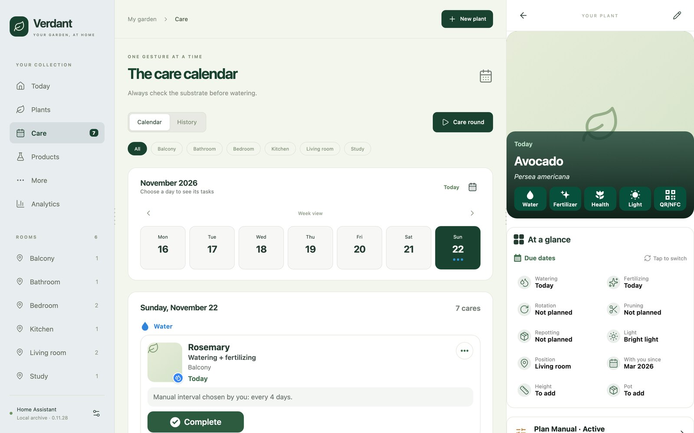
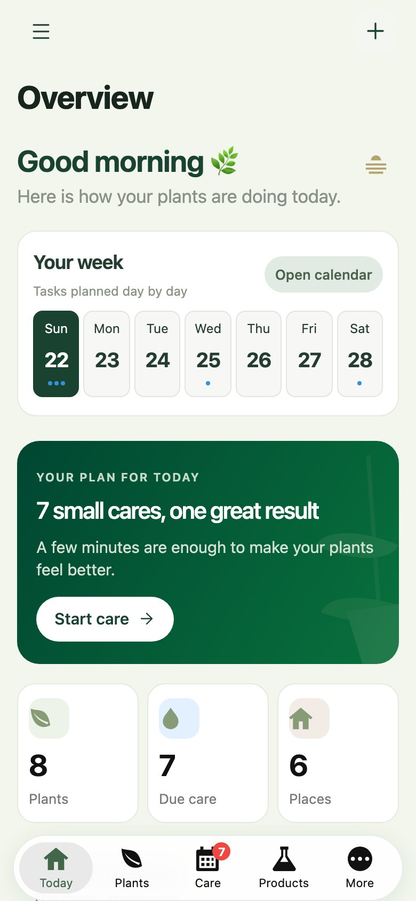
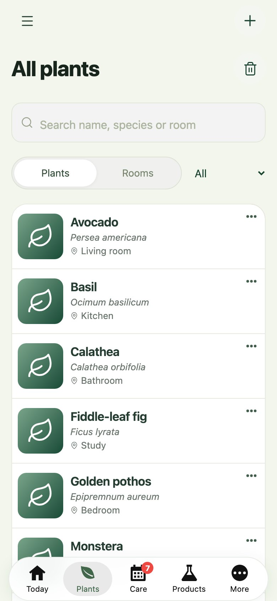
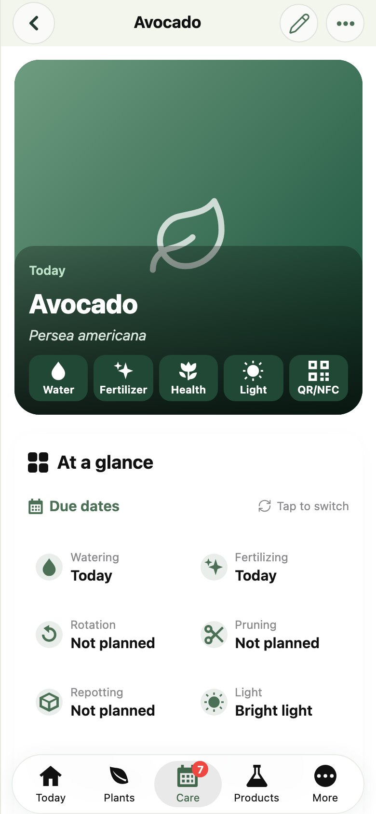
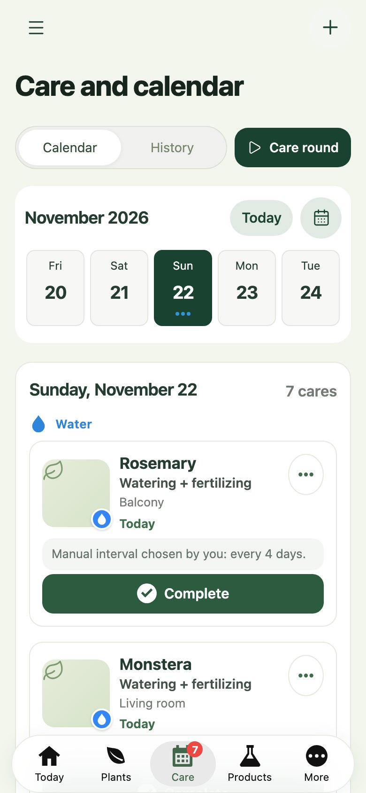

# Verdant per Home Assistant

**La cura delle piante dentro Home Assistant.** Un add-on self-hosted per la tua collezione:
giro di cure, calendario, cronologia, trattamenti, sensori e consigli AI facoltativi — sulla
tua istanza, senza account cloud.

[](https://my.home-assistant.io/redirect/supervisor_add_addon_repository/?repository_url=https%3A%2F%2Fgithub.com%2Fkriptos1970%2Fverdant-ha)

[](https://github.com/kriptos1970/verdant-ha/actions/workflows/ci.yml)
[](https://github.com/kriptos1970/verdant-ha/releases)
[](LICENSE)

<p align="center">
  
</p>

## Perché Verdant

Home Assistant sa leggere un sensore di umidità del terreno, ma non ti dice **cosa fare
oggi**: quale pianta ha sete, cosa hai già completato, cosa hai fatto tre settimane fa e se
una pianta sta migliorando. Verdant è quel flusso di lavoro, come add-on con
un'interfaccia vera: niente dashboard YAML da montare, nessuna seconda app cloud.

## Schermate

| Oggi | Collezione | Pianta |
|:---:|:---:|:---:|
|  |  |  |

<p align="center">
  
</p>

## In sintesi

- **Collezione**: piante, ambienti, prodotti, fotografie, diario di crescita e album salute annotato.
- **Cure**: giro di cure guidato per ambiente, calendario settimanale e mensile, cronologia
  paginata, cicli di trattamento, rinvii e promemoria.
- **Pianificazione**: pianificatore adattivo con regole stagionali e meteo Open-Meteo
  facoltativo. Le piante nuove partono in modalità manuale; il motore operativo può rinviare
  l'annaffiatura con una lettura affidabile del terreno ancora bagnato (attivo per
  impostazione predefinita) e non anticipa mai una cura. Vedi [docs/CARE_ENGINE.md](docs/CARE_ENGINE.md).
- **Sensori**: temperatura, umidità, luce, umidità del terreno e conducibilità dalle entità di
  Home Assistant, associate a una pianta o a un ambiente.
- **Consigli AI (facoltativi)**: Gemini o OpenAI con output strutturato, anteprima esplicita e
  applicazione selettiva. Disattivati per impostazione predefinita; l'applicazione automatica è spenta.
- **Conoscenza**: identificazione Pl@ntNet, catalogo specie iNaturalist, profili Perenual e
  Open Plantbook, nove guide di cura e controllo guidato dei sintomi.
- **Etichette**: QR/NFC che aprono la pianta tramite l'URL stabile del pannello Home Assistant.
- **Dati**: importazione dell'archivio nativo (envelope v1–v3), backup ZIP con checksum SHA256,
  deduplicazione foto e rimozione EXIF, conservazione misure configurabile.
- **Interfaccia web**: responsiva, allineata all'app nativa Verdant alle larghezze telefono;
  funziona dentro Home Assistant Ingress senza esporre porte.

## Installazione su Home Assistant OS

### Repository add-on (consigliato)

1. In Home Assistant aprire **Impostazioni → Add-on → Add-on store**.
2. Menu **⋮** → **Repository** e aggiungere `https://github.com/kriptos1970/verdant-ha`
   (oppure usare il badge qui sopra).
3. Aggiornare l'elenco, aprire **Verdant** e installarlo.
4. Avviare l'add-on e aprire **Interfaccia web**. È disponibile Ingress; non serve esporre porte.
5. Configurare fuso orario, entità consentite, cartella foto e le eventuali chiavi AI/Pl@ntNet
   nelle opzioni dell'add-on.
6. In **Altro → Archivio e backup** caricare il backup esportato dall'app Verdant. L'importazione
   avviene su archivio vuoto, dopo l'anteprima.

Home Assistant controlla `plantcare_web/config.yaml` nel repository: una nuova versione compare
direttamente nell'App store dopo una release.

### Add-on locale (offline o sviluppo)

1. Scaricare l'ultimo `plantcare-web-<versione>.zip` dalle [Release](https://github.com/kriptos1970/verdant-ha/releases) ed estrarlo.
2. Copiare **la cartella `plantcare_web` completa** in `/addons/plantcare_web` tramite Samba o
   Terminal & SSH. Non copiare `.venv`, `node_modules` o archivi personali.
3. Nell'App store di Home Assistant aggiornare l'elenco degli add-on locali e installare **Verdant**.

> L'installazione da repository crea un add-on con slug prefissato dal repository (ad esempio
> `309d34f7_plantcare_web`), quella locale è registrata come `local_plantcare_web`: hanno cartelle
> dati separate. Per passare un'installazione locale al repository, esportare prima il backup ZIP,
> installare l'add-on da repository, reinserire le opzioni e importare lo ZIP sull'archivio vuoto.

Dettagli su opzioni, percorsi dati, backup e ripristino in [docs/INSTALL.md](docs/en/INSTALL.md)
e [docs/DEPLOYMENT.md](docs/DEPLOYMENT.md).

## Privacy e impronta

- Nessun account, nessuna telemetria, nessun servizio esterno necessario per usare la collezione.
- Le ricerche meteo vanno a Open-Meteo. Pl@ntNet, Perenual, Open Plantbook, Gemini e OpenAI
  vengono chiamati solo se aggiungi una chiave.
- Le chiavi API restano nelle opzioni dell'add-on e sono usate solo dal backend.
- L'add-on richiede l'API di Home Assistant per leggere le entità sensore che elenchi e Ingress
  per l'interfaccia. Nessuna host network, nessuna porta esposta.

## Domande frequenti

**Servono i sensori?** No. I sensori sono facoltativi: le scadenze funzionano con intervalli,
stagione e profilo della specie.

**Serve una chiave AI?** No. I consigli AI sono spenti per impostazione predefinita e ogni
proposta passa da un'anteprima prima di essere applicata.

**Dove stanno i dati?** SQLite e foto in `/data` (o `/share` per le foto), inclusi nei backup di
Home Assistant. L'add-on esporta anche uno ZIP con checksum SHA256.

**Sincronizza con l'app nativa Verdant?** No. L'add-on web importa una volta l'archivio nativo;
non c'è sincronizzazione continua.

**Italiano o inglese?** Entrambe, comprese cure, prodotti, trattamenti, guide e diagnosi. Alcune
note lunghe già presenti negli archivi possono restare nella lingua originale.

## Stato

Versione attuale: **1.0.2**, pubblicata nelle [GitHub Releases](https://github.com/kriptos1970/verdant-ha/releases).
Il progetto è utilizzabile e gira su un'installazione Home Assistant reale con un archivio
personale, ma è ancora in sviluppo attivo. Limiti noti e roadmap in [docs/STATUS.md](docs/STATUS.md)
e [ROADMAP.md](ROADMAP.md).

Sotto il cofano: Python 3.13, FastAPI, Pydantic, SQLite, React 19, TypeScript e Vite, confezionati
come add-on Home Assistant per `aarch64` e `amd64`. 225 test backend più type-check e build del
frontend girano in CI a ogni push e pull request.

## Documentazione

- [Installazione, opzioni e backup](docs/en/INSTALL.md)
- [Motore di cura — Manuale, Verdant e AI](docs/CARE_ENGINE.md)
- [Matrice di riferimento](docs/REFERENCE.md)
- [Stato e limiti noti](docs/STATUS.md)
- [Indice della documentazione](docs/README.md)

## Contribuire

Il progetto è aperto a contributi. Leggi [CONTRIBUTING.md](CONTRIBUTING.md) prima di aprire una
pull request. Esegui i test backend e la build frontend:

```sh
.venv/bin/python -m pytest plantcare_web/tests -q
npm run build --prefix plantcare_web/frontend
```

La CI GitHub esegue gli stessi controlli a ogni push e pull request. Non includere credenziali,
archivi personali o fotografie dell'archivio operativo nei commit. Per problemi di sicurezza segui
[SECURITY.md](SECURITY.md), senza aprire issue pubbliche.

Se Verdant ti è utile, una stella aiuta altri utenti Home Assistant a trovarlo.

## Licenza

Distribuito con licenza [MIT](LICENSE). Copyright © 2026 Maurizio Antonio Sicoli.

Verdant è un progetto indipendente dell'autore dell'app nativa Verdant e non è affiliato a Home
Assistant, Pl@ntNet, Perenual, Open Plantbook, iNaturalist, Google o OpenAI, né all'app iOS
“Verdant Grow Intelligence”, che non ha alcun rapporto con questo progetto. I marchi citati
appartengono ai rispettivi proprietari.
