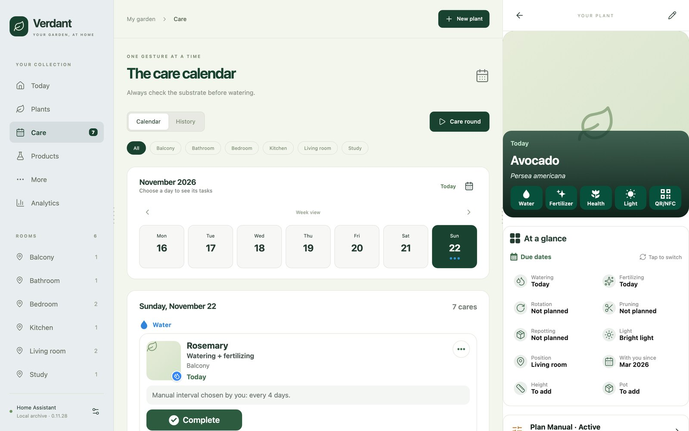
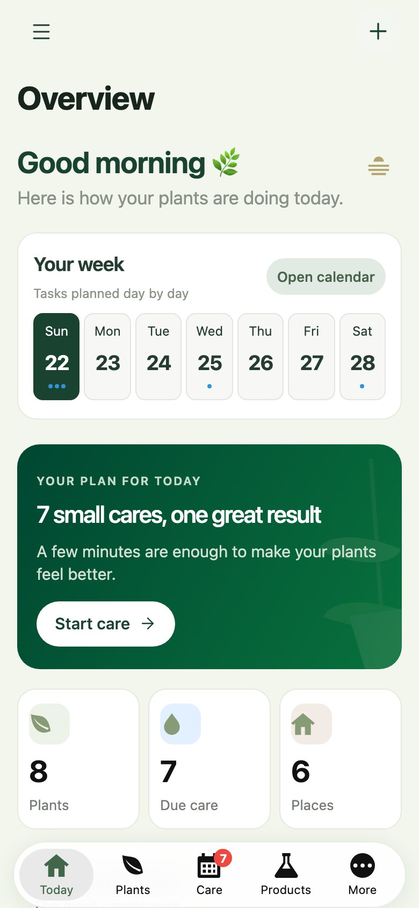
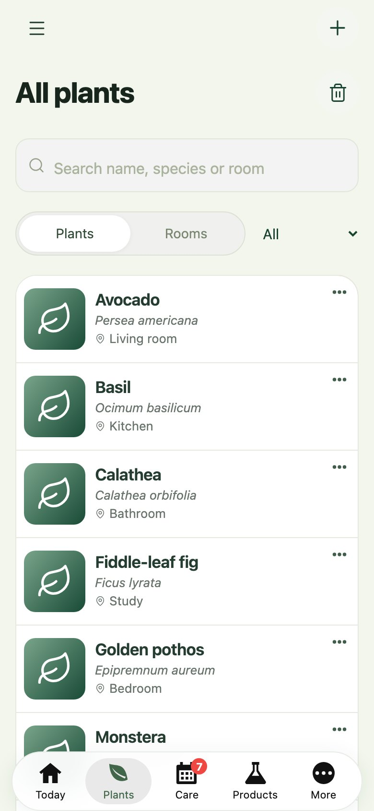
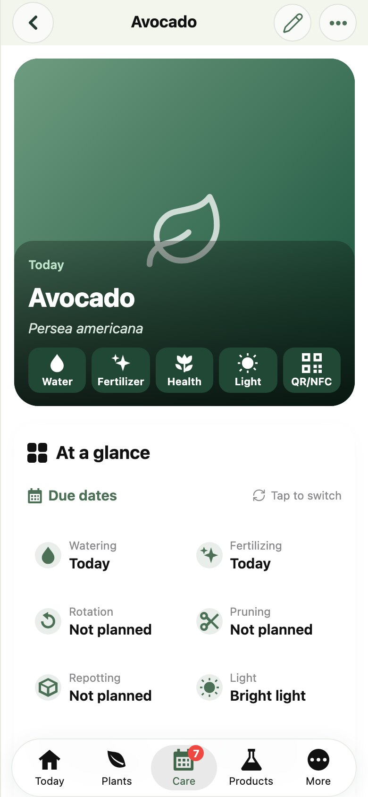
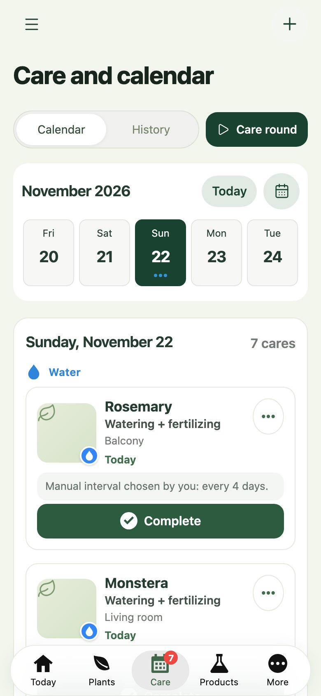

# Verdant HA

**Plant care for Home Assistant.** A self-hosted add-on for your houseplant collection:
care rounds, calendar, history, treatments, sensors and optional AI advice — on your own
instance, with no cloud account.

  

## Why Verdant

Home Assistant can read a soil-moisture sensor, but it does not tell you **what to do
today**: which plant needs water, what you already completed, what you did three weeks
ago, and whether a plant is recovering. Verdant is that missing workflow, as an add-on
with a real interface — no YAML dashboards to assemble, no second cloud app.

## Screenshots

| Today | Collection | Plant |
|:---:|:---:|:---:|
|  |  |  |

  

## Highlights

- **Collection**: plants, rooms, products, photos, growth diary and annotated health album.
- **Care**: guided care rounds by room, weekly and monthly calendar, paginated history,
  treatment cycles, deferrals and reminders.
- **Scheduling**: adaptive planner with seasonal rules and optional Open-Meteo weather. New
  plants start in manual mode; the operational Care Engine can postpone watering on fresh,
  reliable wet-soil readings (default active) and never advances care. See
  [docs/en/CARE_ENGINE.md](docs/en/CARE_ENGINE.md).
- **Sensors**: temperature, humidity, light, soil moisture and conductivity from Home
  Assistant entities, mapped to a plant or a room.
- **AI advice (optional)**: Gemini or OpenAI with structured output, explicit preview and
  selective application. Disabled by default; automatic application is off.
- **Knowledge**: Pl@ntNet plant identification, iNaturalist species catalog, Perenual and
  Open Plantbook profiles, nine care guides and a guided symptom check.
- **Labels**: QR/NFC labels that open the plant through the stable Home Assistant panel URL.
- **Data**: native archive import (envelope v1–v3), ZIP backup with SHA256 checksums, photo
  deduplication and EXIF stripping, configurable measurement retention.
- **Web UI**: responsive, aligned with the native Verdant app at phone widths; works inside
  Home Assistant Ingress without exposing ports.

## Install

### Home Assistant add-on repository (recommended)

1. In Home Assistant open **Settings → Add-ons → Add-on store**.
2. Open the **⋮** menu → **Repositories** and add `https://github.com/kriptos1970/verdant-ha`
   (or use the badge above).
3. Refresh the store, open **Verdant** and install it.
4. Start the add-on and open **Web UI**: it uses Ingress and does not expose a port.
5. Configure timezone, exposed sensor entities, photo directory and optional AI/Pl@ntNet keys
   in the add-on options.
6. To migrate from the native app, use **More → Archive and backup** and import the exported backup.

Home Assistant checks `plantcare_web/config.yaml` in this repository, so a new version is
offered directly in the add-on store after a release.

### Local add-on (offline or development)

1. Download the latest `plantcare-web-<version>.zip` from [Releases](https://github.com/kriptos1970/verdant-ha/releases) and extract it.
2. Copy the `plantcare_web` folder to `/addons/plantcare_web` on your Home Assistant host.
3. Refresh the local add-ons in the Home Assistant App store, install **Verdant** and start it.

> A repository install creates a repository-prefixed add-on (for example `309d34f7_plantcare_web`), while a local install is registered as `local_plantcare_web`. They have separate data volumes. To move an existing local installation to the repository add-on, export the ZIP backup first, install the repository add-on, re-enter the options and import the ZIP on the empty archive.

See [docs/en/INSTALL.md](docs/en/INSTALL.md) for options, data locations, backup and restore.

## Privacy and footprint

- No account, no telemetry, no external service required to use the collection.
- Weather lookups go to Open-Meteo. Pl@ntNet, Perenual, Open Plantbook, Gemini and OpenAI
  are only called when you add a key.
- API keys stay in the add-on options and are used by the backend only.
- The add-on requests the Home Assistant API to read the sensor entities you list, and
  Ingress for the interface. No host network, no exposed ports.

## FAQ

**Do I need sensors?** No. Sensors are optional; care schedules work from intervals, season
and the species profile.

**Do I need an AI key?** No. AI advice is off by default and every proposal is previewed
before it is applied.

**Where is my data?** SQLite and photos under `/data` (or `/share` for photos), included in
Home Assistant backups. The add-on also exports a ZIP with SHA256 checksums.

**Does it sync with the native Verdant app?** No. The web add-on imports the native archive
once; there is no live synchronization.

**Italian or English?** Both, including care flows, products, treatments, guides and
diagnosis. Some long notes already stored in archives may remain in their original language.

## Status

Current version: **1.0.2**, published on [GitHub Releases](https://github.com/kriptos1970/verdant-ha/releases).
The project is usable and runs on a real Home Assistant installation with a personal archive,
but it is still under active development. Known limits and the remaining roadmap are tracked in
[docs/STATUS.md](docs/STATUS.md) and [ROADMAP.md](ROADMAP.md).

Under the hood: Python 3.13, FastAPI, Pydantic, SQLite, React 19, TypeScript and Vite, built as
a Home Assistant add-on for `aarch64` and `amd64`. 225 backend tests plus the frontend
type-check and build run in CI on every push and pull request.

## Documentation

- [Installation, options and backup (English)](docs/en/INSTALL.md)
- [Care engine — Manual, Verdant and AI](docs/en/CARE_ENGINE.md)
- [Architecture and reference matrix (English)](docs/en/REFERENCE.md)
- [Status and known limits (English)](docs/en/STATUS.md)
- [English documentation index](docs/en/README.md)
- [Documentazione completa in italiano](docs/README.md)

## Contributing

Contributions are welcome. Read [CONTRIBUTING.md](CONTRIBUTING.md) before opening a pull
request, run the backend tests and the frontend build, and never commit credentials, personal
archives or photos from a real collection. Report security problems privately as described in
[SECURITY.md](SECURITY.md).

If Verdant is useful to you, a star helps other Home Assistant users find it.

## License

Released under the [MIT License](LICENSE). Copyright © 2026 Maurizio Antonio Sicoli.

Verdant is an independent project by the author of the native Verdant app, and is not
affiliated with Home Assistant, Pl@ntNet, Perenual, Open Plantbook, iNaturalist, Google or
OpenAI, nor with the unrelated “Verdant Grow Intelligence” iOS app. All trademarks belong to
their respective owners.
