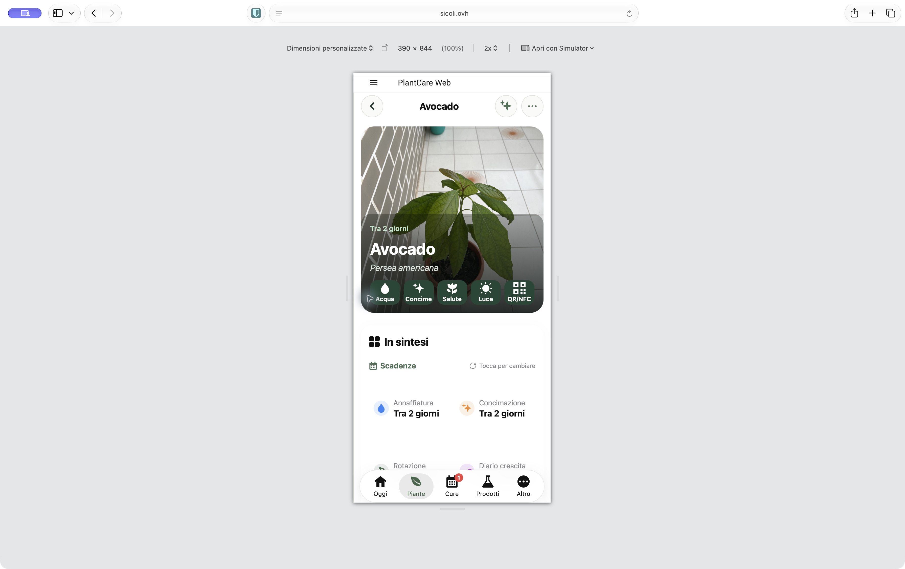

# Verdant HA

**English** | [Italiano](README.it.md)

[](https://github.com/kriptos1970/verdant-ha/actions/workflows/ci.yml)
[](https://github.com/kriptos1970/verdant-ha/releases)
[](LICENSE)

**Verdant** is a self-hosted **Home Assistant add-on** for looking after a houseplant collection: care scheduling, guided care rounds, history, treatments, sensors and optional AI advice.

Everything runs on your own Home Assistant instance, with SQLite and photos stored locally. There is no cloud account and no synchronization with the native Apple apps.

<p align="center">
  
</p>

## Highlights

- **Collection**: plants, rooms, products, photos, growth diary and annotated health album.
- **Care**: guided care rounds by room, weekly and monthly calendar, paginated history, treatment cycles, deferrals and reminders.
- **Scheduling**: adaptive planner with seasonal rules and optional Open-Meteo weather. New plants start in manual mode; the operational Care Engine can postpone watering on fresh, reliable wet-soil readings (default active) and never advances care. See [docs/en/CARE_ENGINE.md](docs/en/CARE_ENGINE.md).
- **Sensors**: temperature, humidity, light, soil moisture and conductivity from Home Assistant entities, mapped to a plant or a room.
- **AI advice (optional)**: Gemini or OpenAI with structured output, explicit preview and selective application. Disabled by default; automatic application is off.
- **Knowledge**: Pl@ntNet plant identification, iNaturalist species catalog, Perenual and Open Plantbook profiles, nine care guides and a guided symptom check.
- **Labels**: QR/NFC labels that open the plant through the stable Home Assistant panel URL.
- **Data**: native archive import (envelope v1–v3), ZIP backup with SHA256 checksums, photo deduplication and EXIF stripping, configurable measurement retention.
- **Web UI**: responsive, aligned with the iOS app at phone widths; works inside Home Assistant Ingress without exposing ports.

## Stack

- Backend: Python 3.13, FastAPI, Pydantic, SQLite.
- Frontend: React 19, TypeScript, Vite.
- Packaging: Home Assistant add-on built from a local Dockerfile (aarch64 and amd64).
- Tests: 224 pytest tests; frontend type-check and build in CI.

## Status

Current version: **0.11.21**, published on [GitHub Releases](https://github.com/kriptos1970/verdant-ha/releases). The project is usable and runs on a real Home Assistant installation with a personal archive, but it is still under active development. The interface is available in Italian and English, including care flows, products, treatments, iOS detail, guides and diagnosis. Some long notes already stored in archives may remain in their original language.

Known limits and the remaining roadmap are tracked in the Italian documentation, starting from [docs/STATUS.md](docs/STATUS.md) and [docs/IOS_LAYOUT.md](docs/IOS_LAYOUT.md). The high-level plan is in [ROADMAP.md](ROADMAP.md).

## Installation

### Home Assistant add-on repository (recommended)

1. In Home Assistant open **Settings → Add-ons → Add-on store**.
2. Open the **⋮** menu → **Repositories** and add `https://github.com/kriptos1970/verdant-ha`.
3. Refresh the store, open **Verdant** and install it.
4. Start the add-on and open **Web UI**: it uses Ingress and does not expose a port.
5. Configure timezone, exposed sensor entities, photo directory and optional AI/Pl@ntNet keys in the add-on options.
6. To migrate from the native app, use **Altro → Archivio e backup** and import the exported backup.

Home Assistant checks `plantcare_web/config.yaml` in the repository, so a new version is offered directly in the add-on store after a release.

### Local add-on (offline or development)

1. Download the latest `plantcare-web-<version>.zip` from [Releases](https://github.com/kriptos1970/verdant-ha/releases) and extract it.
2. Copy the `plantcare_web` folder to `/addons/plantcare_web` on your Home Assistant host.
3. Refresh the local add-ons in the Home Assistant App store, install **Verdant** and start it.

> A repository install creates a repository-prefixed add-on (for example `309d34f7_plantcare_web`), while a local install is registered as `local_plantcare_web`. They have separate data volumes. To move an existing local installation to the repository add-on, export the ZIP backup first, install the repository add-on, re-enter the options and import the ZIP on the empty archive.

See [docs/DEPLOYMENT.md](docs/DEPLOYMENT.md) for the detailed procedure and [docs/IMPORT.md](docs/IMPORT.md) for the import notes.

## Development

```sh
python3 -m venv .venv
.venv/bin/pip install -r plantcare_web/backend/requirements.lock pytest
npm ci --prefix plantcare_web/frontend
npm run build --prefix plantcare_web/frontend
PLANTCARE_DATA=.data .venv/bin/uvicorn plantcare_web.backend.main:app --host 127.0.0.1 --port 8099 --no-proxy-headers
```

Open `http://127.0.0.1:8099/`. For frontend hot reload, run `npm run dev --prefix plantcare_web/frontend` while the backend listens on port 8099.

Run the test suite with:

```sh
.venv/bin/python -m pytest plantcare_web/tests -q
```

The CI workflow runs the same backend tests and the frontend build on every push and pull request.

## Documentation

- [English documentation index](docs/en/README.md)
- [Installation on Home Assistant (English)](docs/en/INSTALL.md)
- [Status and known limits (English)](docs/en/STATUS.md)
- [Architecture and reference matrix (English)](docs/en/REFERENCE.md)
- [Care engine — Manual, Verdant and AI](docs/en/CARE_ENGINE.md)
- [Full Italian reference matrix](docs/REFERENCE.md)
- [Full Italian status and verification notes](docs/STATUS.md)
- [iOS layout comparison (Italian)](docs/IOS_LAYOUT.md)
- [Archive consolidation and performance (Italian)](docs/STEP8.md)

The detailed verification notes remain in Italian; the English pages above cover installation, status and architecture.

## Contributing

Contributions are welcome. Read [CONTRIBUTING.md](CONTRIBUTING.md) before opening a pull request, run the backend tests and the frontend build, and never commit credentials, personal archives or photos from a real collection. Report security problems privately as described in [SECURITY.md](SECURITY.md).

## License

Released under the [MIT License](LICENSE). Copyright © 2026 Maurizio Antonio Sicoli.

Verdant HA is an independent project and is not affiliated with Home Assistant, Pl@ntNet, Perenual, Open Plantbook, iNaturalist, Google or OpenAI. All trademarks belong to their respective owners.
